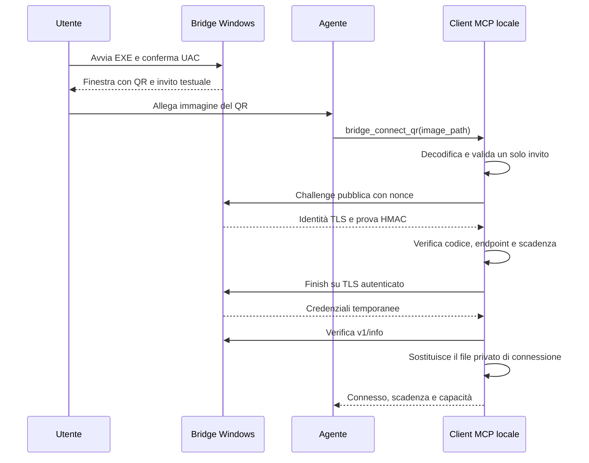

# Proposta: connessione tramite QR

Stato: progetto di riferimento implementato nella build 0.6.0. Per il comportamento attuale vedi [guida rapida](getting-started.md) e [protocollo](protocol.md); sotto restano le decisioni e verifiche del progetto. Base verificata: v0.5.1, commit 69f2bc5.
Destinazione proposta: v0.6.0. Il percorso QR riusa le route HTTPS v1 esistenti; la modalità aggiuntiva con approvazione locale richiede nuove route opzionali.

## Obiettivo e flusso utente

Avviare il bridge su un PC Windows, passare all'agente un'immagine della finestra e ottenere la stessa connessione oggi disponibile con l'invito testuale. Il codice viene estratto da un decoder QR locale; il modello non deve trascriverlo o ricostruirlo.

1. Doppio clic sull'EXE, consenso UAC e avvio del listener come oggi.
2. Finestra con QR, invito testuale selezionabile, scadenza e pulsanti Copia invito, Salva PNG, Arresta bridge.
3. L'utente allega uno screenshot o il PNG alla chat.
4. L'agente chiama `bridge_connect_qr` con il percorso locale dell'immagine.
5. Il client decodifica, valida, completa il pairing e restituisce informazioni sul PC e capacità disponibili.

Prerequisito del punto 4: l'immagine deve essere accessibile al processo MCP sul computer dell'agente. Un allegato visibile al modello non garantisce che quel processo possa aprirlo; la guida dovrà spiegare come salvarlo localmente quando necessario. Il client non recupera immagini attraverso URL o percorsi sul PC remoto.

## Alternativa: IP e approvazione locale

Su richiesta dell'utente, il progetto include anche [richiesta di accesso tramite IP](local-access-approval-design.md): l'agente non riceve l'invito, mostra un codice di confronto e attende Approva/Rifiuta sul PC Windows. La finestra viene estesa con consenso e coda richieste; il protocollo di autorizzazione aggiuntivo va specificato e verificato prima dello sviluppo.

## Decisioni principali

| Aspetto | Scelta per la prima versione |
|---|---|
| Simbologia | QR standard; Data Matrix rimandato |
| Contenuto | Invito breve esistente, byte ASCII invariati |
| Host | Un solo EXE, finestra Win32 nativa e console esistente |
| Client | Nuovo strumento MCP locale, indipendente dal modello usato |
| Immagini in ingresso | PNG e JPEG statici, identificati dalla firma del file |
| Autenticazione | Challenge HMAC, certificato autenticato e token HTTPS attuali |
| Persistenza | Connessione sostituita solo dopo verifica del nuovo host |
| Compatibilità minima | Windows 7 x64 come obiettivo di build, con prova reale richiesta |
| Lettura manuale | Sempre disponibile con `bridge_connect` |

Il QR serve a trasportare l'invito: non aggiunge una nuova prova di identità, non modifica i privilegi concessi e non richiede un servizio esterno.

## Contenuto del QR

Il payload è esattamente la riga breve mostrata nella console, senza prefissi URI, JSON, newline, certificati o bearer:

```text
192.0.2.10:Ab7!kP2@qR9#xT4?
192.0.2.10:9443:Ab7!kP2@qR9#xT4?
[2001:db8::10]:9443:Ab7!kP2@qR9#xT4?
```

Gli indirizzi negli esempi sono riservati alla documentazione e il codice è fittizio.

- Porta implicita 8443; porta esplicita e IPv6 seguono il parser corrente.
- Conservare maiuscole, minuscole e simboli esattamente. Non applicare URL decoding, correzioni OCR o sostituzioni dei caratteri.
- Validare con `pairing::parse_short_invite` e verificare che l'endpoint sia un IP concreto valido anche prima della prima richiesta di rete; estrarre una validazione comune con `connection::ensure_valid` dove utile.
- Per questo strumento rifiutare inviti legacy `wb1_`, URL, testo aggiuntivo e payload oltre 512 byte.
- Il QR resta valido per la sessione del bridge e può essere usato da più agenti, come l'invito attuale. Le singole challenge sono monouso; l'invito non lo è.
- Il payload non contiene una scadenza autonoma: la scadenza autorevole viene verificata durante il pairing.

Un contenuto raw evita ambiguità con `#`, `?`, `+` e `%` presenti nell'alfabeto dei codici. La funzione che formatta l'invito dovrà essere condivisa fra console, QR e testo della finestra.

## Architettura prevista



Punti di integrazione verificati nel codice:

- `src/host.rs` genera oggi l'invito in `run` e controlla scadenza, Ctrl+C e arresto del server.
- `src/bootstrap.rs` gestisce avvio senza argomenti, UAC e durata della regola firewall. Il suo guard deve restare vivo fino al completamento dell'arresto.
- `src/pairing.rs` definisce alfabeto, parser e prove HMAC.
- `src/connection.rs` risolve l'invito e scrive il file privato.
- `src/mcp.rs::connect_bridge` verifica `/v1/info` e sostituisce le credenziali. Entrambi gli strumenti dovranno chiamare questa stessa funzione.

Nuovi moduli proposti:

| Modulo | Responsabilità |
|---|---|
| `src/qr.rs` | Generazione matrice, rendering PNG, caricamento limitato delle immagini, decodifica e selezione dell'invito |
| `src/pairing_ui.rs` | Finestra Win32, clipboard, salvataggio e messaggi di ciclo di vita; stub fuori da Windows |
| `src/pairing.rs` | Formatter condiviso dell'invito e validazione sintattica comune |
| `src/mcp.rs` | Schema, dispatch, errori sanitizzati e chiamata al pairing comune |
| `src/bootstrap.rs`, `src/host.rs`, `src/main.rs` | Opzioni UI e arresto coordinato |

## Finestra sul PC da controllare

La prima versione mantiene la console per log e compatibilità. Il doppio clic apre anche la finestra QR. L'avvio esplicito `host` mantiene il comportamento attuale; `host --qr` abilita la finestra.

Layout previsto: titolo del prodotto, IP e porta, QR centrato, campo di testo selezionabile con l'intero invito, tempo rimanente e tre pulsanti. Il codice deve essere leggibile anche con display al 100%, 150% e 200%.

Rendering: matrice nera su sfondo bianco, moduli quadrati, scala intera senza interpolazione, margine bianco di almeno quattro moduli. Dimensione iniziale: almeno otto pixel per modulo, riducibile fino a quattro su schermi piccoli; mai tagliare il margine. Livello di correzione proposto M; una scelta diversa dovrà essere giustificata dai test su screenshot e JPEG. Non aggiungere loghi o decorazioni sopra il QR.

Usare USER32/GDI e controlli standard già compatibili con Windows 7. Le eventuali API DPI più recenti restano opzionali e risolte dinamicamente. Non chiamare il controllo di compatibilità del desktop remoto per decidere se mostrare questa finestra: QR e cattura/input desktop sono capacità distinte.

- Copia invito: modifica la clipboard solo su click esplicito, usando Unicode e la finestra come proprietario.
- Salva PNG: apre un dialogo locale, propone `winremote-invite.png`, scrive solo nella destinazione scelta e gestisce esplicitamente un file già esistente. Non esportare automaticamente in Desktop, cartelle temporanee o log.
- Il PNG esportato contiene il QR e il margine; il testo leggibile rimane nella finestra.
- Applicare al file esportato protezioni analoghe a quelle del file di connessione prima di scriverne il contenuto. Estrarre un helper comune per i file privati senza cambiare le garanzie di `connection::save/replace`.
- Il file esportato rimane dove scelto dall'utente: la fine della sessione ne rende inutilizzabile l'invito e non elimina file persistenti.

Ciclo di vita:

1. Avviare la UI su un thread dedicato con message loop Win32, dopo che il listener è pronto; nessuna creazione di finestra nei task MCP.
2. X della finestra e Arresta bridge richiedono entrambi l'arresto del bridge.
3. Aggiungere al `select!` dell'host il segnale locale di arresto della UI. La UI non termina direttamente il processo.
4. Ctrl+C, scadenza e errore del server disabilitano invito e pulsanti e chiudono la finestra tramite un messaggio al thread proprietario.
5. Completare il teardown del listener, upload pendenti, UI e regola firewall senza bloccare il runtime sul message loop.
6. Se la UI non può partire, stampare un errore sintetico su stderr e continuare con l'invito testuale. Nessuna apertura ripetuta automatica.

In una sessione senza desktop interattivo resta disponibile la console. La UI non deve richiedere screenshot, plugin desktop, WebView o browser.

## Contratto MCP proposto

Nuovo strumento: `bridge_connect_qr`.

```json
{
  "type": "object",
  "properties": {
    "image_path": {
      "type": "string",
      "description": "Absolute local path to a PNG or JPEG containing the Windows bridge invitation QR."
    }
  },
  "required": ["image_path"],
  "additionalProperties": false
}
```

`image_path` appartiene al computer che esegue il client MCP. Richiedere un percorso assoluto a un file locale regolare; rifiutare percorsi di rete, device e pipe. Aprire una sola volta e applicare i limiti ai byte effettivamente letti, anche se la dimensione dichiarata cambia. Non passare il percorso a una shell.

L'operazione deve essere disponibile prima del pairing e anche quando la connessione precedente è scaduta. Non deve caricare le vecchie credenziali per decodificare il QR.

Limiti iniziali da verificare con i benchmark:

| Risorsa | Limite proposto |
|---|---|
| File compresso | 8 MiB |
| Lato immagine | 8192 pixel |
| Pixel totali | 16.777.216 |
| Payload di un QR | 512 byte |
| Candidati esaminati | 16, poi errore per immagine troppo complessa |
| Passate di decodifica | Due: scala di grigi e inversione, eseguite in sequenza |
| Decodifiche simultanee per processo | Una |
| Budget allocazioni del decoder immagine | 128 MiB, oltre a controlli espliciti su dimensioni e buffer |

Verificare intestazione e dimensioni prima di allocare l'immagine completa; usare aritmetica controllata. Convertire la trasparenza su bianco. Verificare il supporto effettivo dei limiti di ciascun codec: `image::Limits::max_alloc` non è una garanzia universale di memoria del processo. Tenere sotto controllo anche i buffer di scala di grigi e del decoder QR.

Eseguire la decodifica fuori dal runtime async con `spawn_blocking`. Nella prima implementazione il lavoro è limitato da dimensioni e numero di passate, senza promettere un timeout rigido: un timeout async non interrompe una decodifica già avviata. Se i benchmark non danno tempi accettabili, isolare il decoder in un processo terminabile prima di distribuire la funzione.

Scelta del contenuto:

- Nessun invito valido: errore leggibile, senza tentare la rete.
- Più copie dello stesso invito: deduplicare i byte e procedere una sola volta.
- Più inviti diversi e validi: rifiutare l'immagine e chiedere un ritaglio; nessun tentativo automatico su uno degli host.
- QR con URL o contenuti estranei: ignorarli ai fini del pairing; non aprire URL né eseguire istruzioni.
- Invito unico valido: chiamare `connect_bridge`; preservare la connessione precedente se qualunque fase successiva fallisce.

Successo: stesso risultato di `bridge_connect`, senza invito, codice, bearer o byte dell'immagine. Mantenere content testuale e structuredContent secondo la versione MCP negoziata. Il percorso QR porta il catalogo dagli attuali 18 a 19 strumenti; con i due strumenti proposti per l'approvazione locale il totale previsto diventa 21.

Errori operativi proposti: file non disponibile, immagine non supportata, limiti superati, QR assente/non leggibile, inviti ambigui, invito non valido/scaduto, host non verificabile, salvataggio fallito. Mappare questi casi su `isError` con messaggi sanitizzati; uno schema di argomenti errato resta un errore di argomenti. Non riportare payload decodificati o catene di errori contenenti credenziali.

## Dipendenze candidate

Scelte da confermare durante lo spike compilabile; non aggiunte a Cargo.toml in questa fase.

- [qrcode 0.14.1](https://docs.rs/qrcode/0.14.1/qrcode/), con feature predefinite disabilitate: generazione della matrice; rendering diretto tramite il crate `png` già presente.
- [quircs 0.10.3](https://docs.rs/quircs/0.10.3/quircs/): decodifica di buffer in scala di grigi sul lato agente.
- [image](https://docs.rs/image/latest/image/), con sole feature PNG/JPEG: caricamento limitato delle immagini. Bloccare la versione risolta nel lockfile dopo verifica di MSRV, dipendenze transitive e target legacy.
- `windows-sys` già presente: aggiungere solo le feature necessarie per clipboard, memoria globale e dialogo di salvataggio.

Nessuna dipendenza da Python, OpenCV, servizi cloud o librerie DLL da installare per usare l'EXE. Questa è una scelta di progetto da verificare con una build completa e un controllo degli import.

Riferimenti tecnici: [feature di qrcode](https://docs.rs/crate/qrcode/0.14.1/features), [limiti del decoder image](https://docs.rs/image/latest/image/struct.Limits.html), [margine del QR secondo DENSO WAVE](https://www.qrcode.com/en/howto/code.html), [clipboard Win32 e ownership della memoria](https://learn.microsoft.com/en-us/windows/win32/api/winuser/nf-winuser-setclipboarddata).

## Piano di implementazione e verifiche

### 1. Codec e formato condiviso

Implementare formatter, generazione e lettura offline. Verificare Windows 7 build prima di collegare la UI.

Criteri: round trip IPv4/IPv6 e porte diverse; tutti i simboli consentiti; nessuna alterazione del codice; PNG e JPEG; screenshot con bordi e testo attorno; trasparenza; rotazioni; riduzione delle dimensioni; file troncati e dimensioni eccessive. Misurare latenza, memoria e incremento dell'EXE sul corpus di prova.

### 2. Strumento MCP e pairing

Aggiungere schema e dispatch; riutilizzare `connect_bridge`.

Criteri: successo con host locale reale, immagine letta senza connessione precedente, codice errato, invito scaduto, host irraggiungibile, due inviti diversi e QR estranei. Per gli errori di decodifica verificare che non partano richieste HTTP. Verificare conservazione delle vecchie credenziali e assenza di segreti nei risultati/errori.

### 3. Finestra e arresto

Aggiungere QR al doppio clic e opzione esplicita `host --qr`; implementare Copia, Salva PNG e Arresta.

Criteri: chiusura da X, Ctrl+C e scadenza; errore UI con fallback console; nessuna UI in modalità MCP; stderr/stdout invariati per il protocollo. Verificare clipboard occupata, annullamento/esportazione fallita, file esistente, DPI diversi e RDP.

### 4. Richieste tramite IP e consenso locale

Seguire il [progetto dedicato](local-access-approval-design.md), iniziando dalla specifica del legame fra richiesta, confronto umano e canale TLS. Questa modalità non deve ridurre le garanzie del pairing QR/testuale e resta disabilitata senza UI disponibile.

### 5. Build e rilascio

Eseguire suite esistente, smoke MCP/desktop, audit PE della build Win7 e prova manuale su Windows moderno e Server 2012 R2. La compatibilità Windows 7 va confermata su un sistema reale; la sola CI moderna non la dimostra.

Aggiornare README, installazione MCP, troubleshooting, protocollo, changelog e roadmap. L'host aggiornato continua a funzionare con client precedenti tramite il testo; per usare `bridge_connect_qr` occorre aggiornare il client MCP e ricaricare il suo catalogo strumenti.

## Fuori dalla prima versione

Data Matrix, lettura da webcam, scansione continua del monitor, QR cloud, discovery automatico della LAN, inviti monouso, rotazione del codice durante la sessione, relay di immagini non disponibili al processo MCP e modifiche al controllo del desktop.
